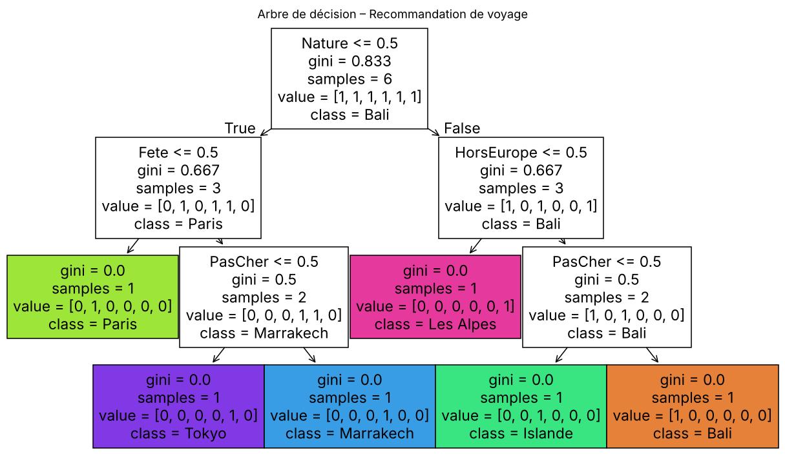

<h1 align="center">AI Voyage – Recommandation de destinations par arbre de décision</h1>

<p align="center">
  <b>Projet universitaire • Python • Machine Learning • Tkinter</b>
</p>

<p align="center">
  
  
  
  
</p>

---

## Présentation du projet
AI Voyage est une application de bureau en **Python** qui recommande une destination de voyage à partir des préférences de l'utilisateur.

L'utilisateur répond à **6 questions par oui ou par non** (climat chaud, nature, budget, voyage hors d'Europe, richesse culturelle, fête). Un **arbre de décision** entraîné avec **scikit-learn** analyse ses réponses et lui propose l'une des **6 destinations**, illustrée par une photo.

---

## Fonctionnement
1. **Données d'entraînement** : chaque destination est décrite par 6 caractéristiques binaires (par exemple, Bali : chaud, nature, pas cher, hors Europe).
2. **Modèle** : un `DecisionTreeClassifier` de scikit-learn apprend à associer un profil de réponses à une destination.
3. **Prédiction** : les réponses de l'utilisateur forment un vecteur de 6 valeurs, transmis au modèle qui renvoie la destination recommandée.
4. **Explicabilité** : un bouton affiche l'arbre de décision avec Matplotlib, pour comprendre comment la recommandation est faite.

<p align="center">
  
</p>

---

## Destinations
<p align="center">
  
  
  
</p>
<p align="center">
  
  
  
</p>

---

## Technologies
- **Python**
- **scikit-learn** : arbre de décision (`DecisionTreeClassifier`)
- **Tkinter** : interface graphique
- **Pillow** : affichage des images
- **Matplotlib** : visualisation de l'arbre

---

## Lancer l'application
```bash
pip install scikit-learn pillow matplotlib numpy
python voyage_tkinter.py
```

---

<p align="center">
  <i>Dépôt destiné à la présentation du projet dans un cadre académique (portfolio).</i>
</p>
